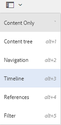

# 타임라인의 활동 스트림 {#activity-stream-in-timeline}

이 기능은 타임라인에 에셋에 대한 활동 로그를 표시합니다. [!DNL Adobe Experience Manager Assets]에서 다음 자산 관련 작업을 수행하는 경우 활동 스트림 기능이 해당 활동을 반영하도록 타임라인을 업데이트합니다.

다음 작업이 활동 스트림에 기록됩니다.

* 만들기
* 삭제
* 다운로드(렌디션 포함)
* 게시
* 게시 취소
* 승인
* 거부
* 이동

The activity logs to be displayed in the timeline are fetched from the location `/var/audit/com.day.cq.dam/content/dam` in CRX, where log files are stored. 또한 [Adobe 자산 링크](https://helpx.adobe.com/enterprise/admin-guide.html/enterprise/using/manage-assets-using-adobe-asset-link.ug.html) 또는 [Experience Manager 데스크톱 앱](https://experienceleague.adobe.com/docs/experience-manager-desktop-app/using/release-notes.html)을 통해 새 자산을 업로드하거나 기존 자산을 수정하고 [!DNL Experience Manager]에 체크 인하면 타임라인 활동이 기록됩니다.

>[!NOTE]
>
>내역 정보가 저장되지 않아 임시 워크플로우는 타임라인에 표시되지 않습니다.

활동 스트림을 보려면 에셋에서 하나 이상의 작업을 수행하고 에셋을 선택한 다음 GlobalNav 목록에서 **[!UICONTROL 타임라인]**&#x200B;을 선택합니다.

타임라인에는 에셋에서 수행하는 작업에 대한 활동 스트림이 표시됩니다.

>[!NOTE]
>
>The default log storage location for **[!UICONTROL Publish]** and **[!UICONTROL Unpublish]** tasks is `/var/audit/com.day.cq.replication/content`. For **[!UICONTROL Move]** tasks, the default location is `/var/audit/com.day.cq.wcm.core.page`.
