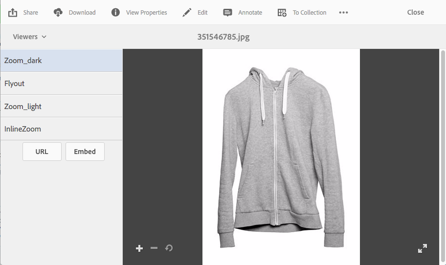

# Dynamic Media 뷰어 사전 설정 적용 {#applying-viewer-presets}

뷰어 사전 설정은 사용자가 컴퓨터 화면 및 모바일 장치에서 리치 미디어 에셋을 보는 방법을 결정하는 설정 컬렉션입니다. 관리자가 만든 뷰어 사전 설정을 에셋에 적용할 수 있습니다.

관리자로서 뷰어 사전 설정을 관리, 만들기, 정렬 및 삭제해야 하는 경우 [뷰어 사전 설정 관리](managing-viewer-presets.md)를 참조하십시오.

[뷰어 사전 설정 게시](managing-viewer-presets.md#publishing-viewer-presets)도 참조하세요.

사용 중인 게시 모드에 따라 뷰어 사전 설정을 게시할 필요가 없습니다.
뷰어 사전 설정에 문제가 있으면 [Dynamic Media 문제 해결 - Scene7](troubleshoot-dms7.md#viewers)을 참조하세요.

## 자산에 Dynamic Media 뷰어 사전 설정 적용 {#applying-a-viewer-preset-to-an-asset}

1. 에셋을 열고 왼쪽 레일에서 **[!UICONTROL 뷰어]**&#x200B;를 선택합니다.

   

   * The **[!UICONTROL URL]** and **[!UICONTROL Embed]** buttons appear after you select a viewer preset.
   * The system shows numerous viewer presets when you select Viewers in an asset&#39;s **[!UICONTROL Detail View]**. You can increase the number of presets seen. [표시되는 뷰어 사전 설정 수 늘리기](managing-viewer-presets.md)를 참조하십시오.

1. 오른쪽 창에 표시되는 에셋에 적용할 수 있도록 왼쪽 창에서 뷰어를 선택합니다. [공유할 URL을 복사](linking-urls-to-yourwebapplication.md)할 수도 있습니다.

## 뷰어 사전 설정 URL 얻기 {#obtaining-viewer-preset-urls}

뷰어 사전 설정에 대한 URL을 가져오려면 [웹 애플리케이션에 URL 연결](linking-urls-to-yourwebapplication.md)을 참조하십시오.
