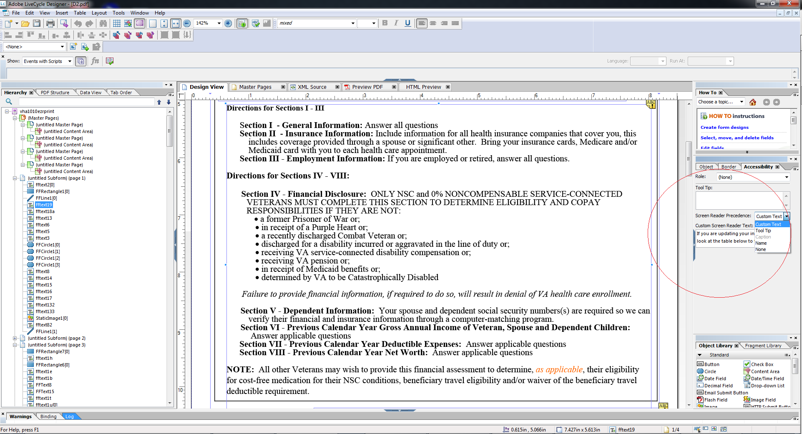

# 접근성 높은 HTML5 양식 디자인 {#designing-accessible-html-forms}

HTML5 forms는 ARIA HTML5 접근성 표준을 사용하여 액세스 가능한 HTML 양식을 생성합니다. 이러한 양식은 탭 탐색을 지원하며(Mozilla FireFox 제외), 일반 화면 판독기와 호환되도록 인증되었습니다. 접근성 기능이 좋은 HTML5 양식을 생성하려면 몇 가지 기본 디자인 지침을 기반으로 XFA 양식 템플릿을 디자인하십시오. 디자인 지침에는 올바른 탭 순서 구성과 각 양식 컨트롤에 대한 텍스트 말하기 콘텐츠 제공이 포함되어 있습니다. AEM Forms Designer은 액세스 가능한 PDF 및 HTML5 양식을 생성하기 위해 이러한 양식 제어 속성 설정을 지원합니다.

*참고:Tabbed 탐색에서는 값의 합계를 표시하는 계산 필드와 같은 보호된 필드를 포함하지 않습니다. 화면 판독기에서 보호된 필드의 값을 읽으려면 보호된 필드의 위나 옆에 빈 읽기 전용 필드를 배치하십시오. 보호된 필드의 값을 새 읽기 전용 필드에 할당합니다. 화면 판독기 또는 탭 탐색에서 이 읽기 전용 필드를 선택하여 보호된 필드의 값으로 말할 수 있습니다.*

AEM Forms Designer에는 화면 판독기에 전달할 수 있는 몇 가지 텍스트 말하기 옵션이 포함되어 있습니다. 양식의 각 개체에 대해 화면 판독기 텍스트에 대한 여러 설정 중 하나를 지정할 수 있습니다.

* 접근성 팔레트를 사용하여 설정할 수 있는 사용자 정의 화면 판독기 텍스트입니다. 작성자는 버튼과 필드의 이름과 목적에 주석을 달 수 있습니다.
* 도구 설명. 접근성 팔레트에서 설정할 수 있습니다.
* 양식의 필드 캡션
* 바인딩 탭의 이름 옵션에 지정된 개체의 이름입니다.

Form 컨트롤에서 도구 설명, 화면 Reader 텍스트 및 캡션과 같은 여러 옵션을 사용할 수 있는 경우 화면 Reader에서는 이러한 속성 중 하나만 사용합니다. 기본 순서는 사용자 정의 화면 Reader 텍스트, 도구 설명, 캡션 및 이름입니다. [액세스 가능성] 팔레트의 [화면 Reader] **우선 순위** 옵션을 사용하여 기본 순서를 재정의할 수 있습니다.
