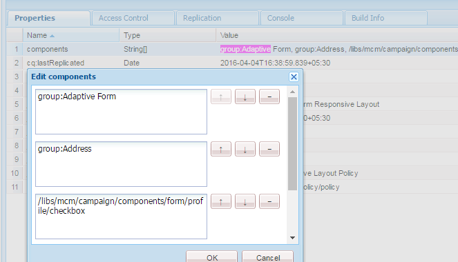

# 사용된 템플릿을 기반으로 구성 요소 표시{#displaying-components-based-on-the-template-used}

양식 작성자가 [템플릿](../../forms/using/template-editor.md)을(를) 사용하여 적응형 양식을 만들 때 양식 작성자는 템플릿 정책에 따라 특정 구성 요소를 보고 사용할 수 있습니다. 양식 작성 시 양식 작성자에게 표시되는 구성 요소 그룹을 선택할 수 있는 템플릿 콘텐츠 정책을 지정할 수 있습니다.

## 템플릿의 콘텐츠 정책 변경 {#changing-the-content-policy-of-a-template}

템플릿을 만들면 콘텐츠 저장소의 `/conf` 아래에 템플릿이 만들어집니다. `/conf` 디렉터리에서 만든 폴더를 기준으로 서식 파일의 경로는 `/conf/<your-folder>/settings/wcm/templates/<your-template>`입니다.

템플릿의 콘텐츠 정책에 따라 사이드바에 구성 요소를 표시하려면 다음 단계를 수행하십시오.

1. CRXDE lite를 엽니다.\
   URL: `https://<server>:<port>/crx/de/index.jsp`
1. CRXDE에서 템플릿이 생성된 폴더로 이동합니다.

   예를 들어`/conf/<your-folder>/`

1. CRXDE에서 다음 위치로 이동합니다. `/conf/<your-folder>/settings/wcm/policies/fd/af/layouts/gridFluidLayout/`

   구성 요소 그룹을 선택하려면 새 콘텐츠 정책이 필요합니다. 정책을 생성하려면 기본 정책을 복사하여 붙여넣은 다음 이름을 바꿉니다.

   기본 콘텐츠 정책 경로: `/conf/<your-folder>/settings/wcm/policies/fd/af/layouts/gridFluidLayout/default`

   `gridFluidLayout` 폴더에서 기본 정책을 복사하여 붙여 넣고 이름을 바꿉니다. 예: `myPolicy`

   

1. 만든 새 정책을 선택하고 오른쪽 패널에서 `string[]` 형식의 **구성 요소** 속성을 선택합니다.

   구성 요소 속성을 선택하고 열면 구성 요소 편집 대화 상자가 표시됩니다. 구성 요소 편집 대화 상자에서는 **+** 및 **-** 단추를 사용하여 구성 요소 그룹을 추가하거나 제거할 수 있습니다. 작성자가 사용할 양식의 구성 요소를 포함하는 구성 요소 그룹을 추가할 수 있습니다.

   

   구성 요소 그룹을 추가한 후 **확인**&#x200B;을 클릭하여 목록을 업데이트한 다음 CRXDE 주소 표시줄 위에 있는 **모두 저장**&#x200B;을 클릭하고 새로 고칩니다.

1. 템플릿에서 컨텐츠 정책을 기본에서 새 정책(새로 만든 정책)으로 변경합니다. ( 이 예제의 `myPolicy`)

   정책을 변경하려면 CRXDE에서 `/conf/<your-folder>/settings/wcm/templates/<your-template>/policies/jcr:content/guideContainer/rootPanel/items`(으)로 이동합니다.

   `cq:policy` 속성에서 `default`을(를) 새 정책 이름(`myPolicy`)으로 변경합니다.

   

   템플릿을 사용하여 만든 양식을 작성할 때 사이드바에 추가된 구성 요소를 볼 수 있습니다.
