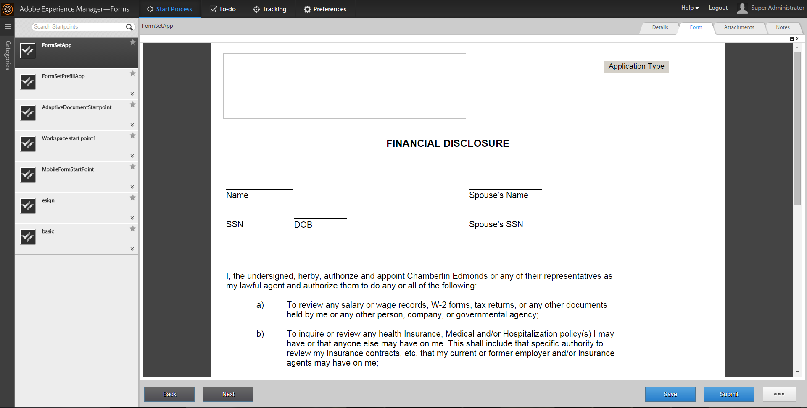

# AEM Forms Workspace에서 양식 집합 작업{#working-with-formsets-in-aem-forms-workspace}

formset은 그룹화되어 최종 사용자에게 단일 양식 세트로 제공되는 HTML5 양식의 컬렉션입니다. 최종 사용자가 양식 세트를 채우기 시작하면 한 양식에서 다른 양식으로 원활하게 전환됩니다. 그런 다음 한 번의 클릭으로 양식 세트를 제출할 수 있습니다. 양식 집합 및 설정 방법에 대한 자세한 내용은 [AEM Forms의 양식 집합](../../forms/using/formset-in-aem-forms.md)을 참조하세요.

AEM Forms 작업 영역은 양식 세트를 지원합니다. 양식 세트를 사용하면 서비스 또는 프로세스와 관련된 여러 양식을 그룹화하여 비즈니스 프로세스를 자동화하고 최종 사용자에게 제공할 수 있습니다. 이러한 시나리오에서는 사용자가 전체 세트를 하나로 채울 수 있으며 개별 양식 또는 프로세스를 파일, 제출 및 추적할 필요가 없습니다.

## AEM Forms 작업 영역 앱에서 시작 지점에 양식 세트 첨부 {#attaching-a-formset-to-startpoint-in-an-aem-forms-workspace-app-br}

1. Workbench에서 업무 프로세스 워크플로우를 생성합니다. 자세한 내용은 [Workbench 도움말](https://www.adobe.com/go/learn_aemforms_workbench_63)을 참조하세요.
1. 시작 지점의 프로세스 속성에서 프레젠테이션 및 데이터의 **CRX 자산 사용**&#x200B;을 선택합니다.

   

1. CRX 자산 경로 옆에 있는 (찾아보기)를 클릭합니다. 양식 에셋 선택 대화 상자가 나타납니다.

   

1. **Formset** 탭을 클릭하고 목록에서 관련 Formset을 선택한 다음 **확인**&#x200B;을 클릭합니다.

1. 다른 관련 프로세스 속성을 업데이트한 후 애플리케이션을 배포합니다.

## AEM Forms 작업 영역에서 양식 세트 사용 {#using-formset-in-nbsp-aem-forms-workspace}

Formset이 startpoint에 연결되면 AEM Forms 작업 영역에서 다른 startpoint가 호출될 때 startpoint를 호출할 수 있습니다.

AEM Forms 작업 영역을 통해 formset에서 지원되는 작업은 다음과 같습니다.

* 초안으로 저장
* 잠금
* 중단
* 제출
* 첨부 파일 추가
* 메모 추가
* 뒤로 또는 다음 단추를 사용하여 양식 세트에서 양식 간에 이동

>[!NOTE]
>
>양식 세트의 이전 및 다음 양식에서 이동하는 동안 성능 향상을 위해 관련 양식이 완전히 렌더링될 때까지 모든 작업 영역 버튼(뒤로, 다음, 저장, 제출 및 ... (계속))이 비활성화됩니다.
