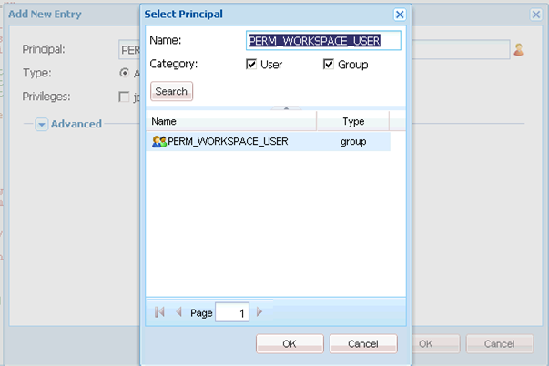

# AEM Forms Workspace 사용자 정의를 위한 일반 단계 {#generic-steps-for-aem-forms-workspace-customization}

사용자 정의를 수행하는 일반 단계는 다음과 같습니다.

1. `https://'[server]:[port]'/lc/crx/de/index.jsp`에 액세스하여 CRXDE Lite에 로그인합니다.
1. `/apps`에 이름이 `ws`인 `sling:Folder` 폴더가 없는 경우 만듭니다. `sling:Folder` 폴더를 만들려면 `apps` 폴더를 마우스 오른쪽 단추로 클릭하고 **[!UICONTROL 만들기]** > **[!UICONTROL 노드 만들기]**&#x200B;를 선택합니다. 이름을 `ws`(으)로 지정하고 `sling:Folder`(으)로 유형을 선택한 다음 **[!UICONTROL 확인]**&#x200B;을 클릭합니다. **[!UICONTROL 모두 저장]**&#x200B;을 클릭합니다.
1. `/apps/ws`(으)로 이동한 다음 **[!UICONTROL 액세스 제어]** 탭으로 이동합니다.
1. **[!UICONTROL 저장소]** 옵션을 선택하십시오. **[!UICONTROL 액세스 제어]** 목록에서 **[!UICONTROL +]**&#x200B;을(를) 클릭하여 항목을 추가합니다. **[!UICONTROL +]**&#x200B;을(를) 다시 클릭합니다.
1. **PERM_WORKSPACE_USER** 주체를 검색하고 선택하십시오.

   

1. `jcr:read` 권한을 사용자에게 부여합니다.
1. **[!UICONTROL 모두 저장]**&#x200B;을 클릭합니다.
1. `/libs/ws` 폴더에서 `/apps/ws` 폴더로 `GET.jsp`, `index` 및 `html.jsp` 파일을 복사합니다.
1. `/apps/ws` 폴더의 `/libs/ws/locales` 폴더를 복사합니다. **[!UICONTROL 모두 저장]**&#x200B;을 클릭합니다.
1. 아래와 같이 `GET.jsp` 파일의 참조 및 상대 경로를 업데이트한 다음 **[!UICONTROL 모두 저장]**&#x200B;을 클릭합니다.

   ```javascript
   <meta http-equiv="refresh" content="0;URL='/lc/apps/ws/index.html'" />
   ```

1. CSS 사용자 정의에 대해 다음을 수행합니다.

   1. `/apps/ws` 폴더로 이동하여 `css` 폴더를 만듭니다.

   1. `css` 폴더에서 `newStyle.css` 파일을 만듭니다.

   1. `/apps/ws/html`.jsp를 열고 다음에서 변경

   ```javascript
   <link lang="en" rel="stylesheet" type="text/css" href="css/style.css" />
   <link lang="en" rel="stylesheet" type="text/css" href="css/jquery-ui.css"/>
   ```

   대상

   ```javascript
   <link lang="en" rel="stylesheet" type="text/css" href="../../libs/ws/css/style.css" />
   <link lang="en" rel="stylesheet" type="text/css" href="css/newStyle.css" />
   <link lang="en" rel="stylesheet" type="text/css" href="../../libs/ws/css/jquery-ui.css"/>
   ```

   >[!NOTE]
   >
   >위에 표시된 대로 style.css 항목 뒤에 사용자 정의 CSS 파일의 항목을 배치합니다.

1. /apps/ws/html.jsp 파일에서

   ```jsp
   <script data-main="js/main" src="js/libs/require/require.js"></script>
   ```

   대상

   ```jsp
   <script data-main="js/main" src="../../libs/ws/js/libs/require/require.js"></script>
   ```

1. 다음 작업을 수행합니다.

   1. `/apps/ws`에 이름이 `js`인 폴더를 만듭니다. **[!UICONTROL 모두 저장]**&#x200B;을 클릭합니다.

   1. `/apps/ws/js`에 이름이 `libs`인 폴더를 만듭니다. **[!UICONTROL 모두 저장]**&#x200B;을 클릭합니다.

   1. `/libs/ws/js/libs/jqueryui` 폴더를 `/apps/ws/js/libs`(으)로 복사합니다. **[!UICONTROL 모두 저장]**&#x200B;을 클릭합니다.

1. HTML 사용자 지정에 대해 다음 작업을 수행하십시오.

   1. `/apps/ws/js`에서 `runtime` 폴더를 만듭니다. **[!UICONTROL 모두 저장]**&#x200B;을 클릭합니다.

   1. `/apps/ws/js/runtime`에서 `templates` 폴더를 만듭니다. **[!UICONTROL 모두 저장]**&#x200B;을 클릭합니다.

   1. `/libs/ws/js/main.js`을(를) `/apps/ws/js/main.js`에 복사합니다.

   1. /libs/ws/js/registry.js을 `/apps/ws/js/registry.js`에 복사합니다.

1. **[!UICONTROL 모두 저장]**&#x200B;을 클릭하고 캐시를 지운 다음 AEM Forms 작업 영역을 새로 고칩니다.

   URL `https://'[server]:[port]'/lc/ws`에 액세스하여 관리자/암호 자격 증명으로 로그인합니다. 브라우저가 `https://'[server]:[port]'/lc/apps/ws/index.html`(으)로 리디렉션됩니다.
