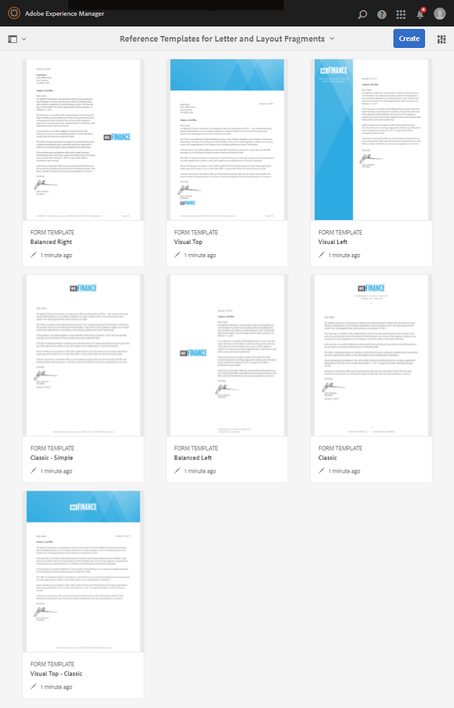
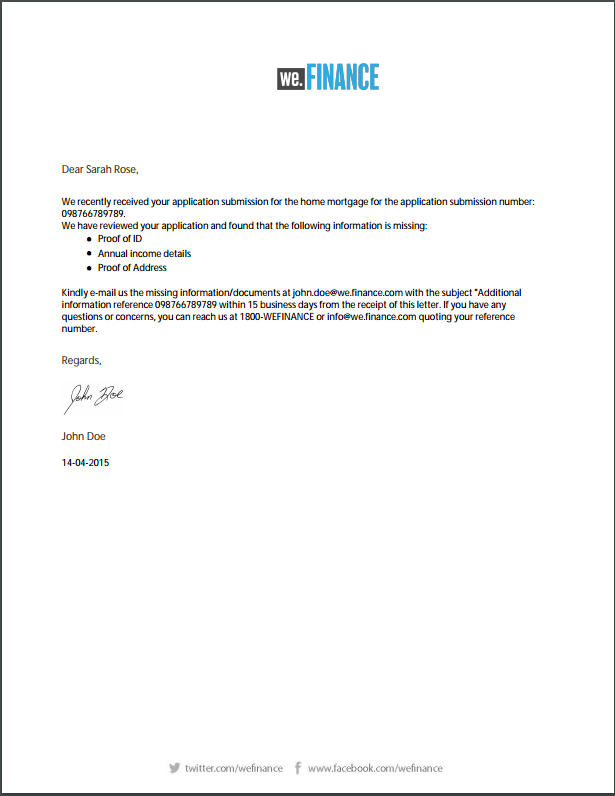
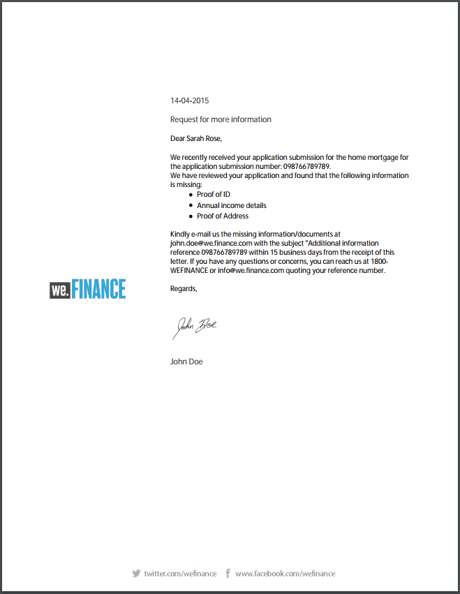
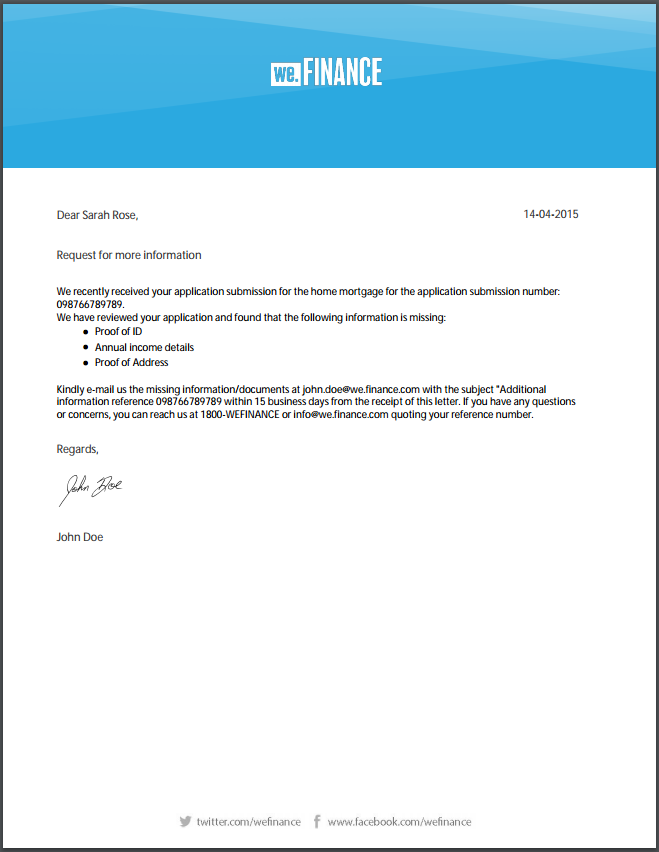

# 추천서 템플릿 {#reference-letter-templates}

서신 관리에서 편지 템플릿에는 일반적인 양식 필드, 머리글 및 바닥글과 같은 레이아웃 기능 및 컨텐츠 배치에 대한 빈 &quot;대상 영역&quot;이 포함되어 있습니다.

서신 관리에서 [AEM Forms 추가 기능 패키지](https://experienceleague.adobe.com/docs/experience-manager-release-information/aem-release-updates/forms-updates/aem-forms-releases.html?lang=ko)에 편지 템플릿을 제공합니다. 브랜딩 및 비즈니스 요구 사항에 따라 Designer에서 템플릿을 사용자 정의할 수 있습니다. 패키지에는 다음 템플릿이 포함됩니다.

* Classic
* 클래식 단순
* 왼쪽 균등
* 균형 있는 오른쪽
* 시각적 왼쪽
* 비주얼 탑
* 비주얼 탑 - 클래식

패키지를 설치하면 레이아웃 템플릿(XDP)이 다음 위치의 templates-folder에 나열됩니다.

`https://'[server]:[port]'/[context-root]/aem/forms.html/content/dam/formsanddocuments/templates-folder`

다음은 이 패키지의 모든 템플릿에 있는 공통 필드입니다.

* 날짜
* 인사말
* 텍스트 닫기
* 서명 텍스트

AEM-FORMS-6.3-REFERENCE-LAYOUT-TEMPLATES 패키지를 설치하면 템플릿이 templates-folder에 나열됩니다

## Classic {#classic}

맨 위에 로고가 있는 클래식 템플릿은 평범한 전문 용지에 적합합니다.

클래식 템플릿을 사용하여 만든 편지의 PDF 미리보기

## 클래식 단순 {#classic-simple}

전화 번호 및 이메일 주소를 캡처하는 필드를 포함합니다. Classic Simple 템플릿은 수신자 주소를 입력할 수 있는 필드가 없다는 점을 제외하면 Classic 템플릿과 유사합니다.

Classic Simple 템플릿을 사용하여 만든 편지의 PDF 미리보기

## 왼쪽 균등 {#balanced-left}

왼쪽 균형이 조정된 템플릿에는 편지 왼쪽에 로고가 포함됩니다.

왼쪽 균형이 조정된 템플릿을 사용하여 만든 편지의 PDF 미리보기

## 균형 있는 오른쪽 {#balanced-right}

오른쪽 균형 조정 템플릿의 왼쪽에는 회사 로고가 있으며 편지 자체에 수신자 주소를 입력할 수 있는 공간을 제공합니다. 오른쪽 균형 조정 템플릿에는 편지에 여러 페이지가 있을 때 리플로우되는 바닥글도 포함됩니다.

오른쪽 균형 조정 템플릿을 사용하여 만든 편지의 PDF 미리보기

## 시각적 왼쪽 {#visual-left}

시각적 왼쪽 템플릿에는 페이지 왼쪽에 사이드 헤드가 있고 사이드 헤드 위에 회사 로고가 배치됩니다. 시각적 왼쪽 템플릿에는 제목 필드는 있지만 바닥글은 없습니다.

시각적 왼쪽 템플릿을 사용하여 만든 편지의 PDF 미리보기

## 비주얼 탑 {#visual-top}

비주얼 상단 템플릿의 맨 위에는 시각적 여백이 있습니다. Visual Top 템플릿에는 페이지 자체에 수신자 주소를 입력하는 필드가 있습니다. 비주얼 상단 템플릿에는 여러 페이지로 확장되는 문자가 리플로우되는 제목 필드와 바닥글이 있습니다.

비주얼 상단 템플릿을 사용하여 만든 편지의 PDF 미리보기

## 비주얼 탑 - 클래식 {#visual-top-classic}

Visual Top - Classic 템플릿의 페이지 맨 위에는 회사 로고가 있는 머리글이 있습니다. Visual Top - Classic 템플릿에는 제목을 입력할 수 있는 필드가 있지만 바닥글은 입력할 수 없습니다.

Visual Top - Classic 템플릿을 사용하여 만든 편지의 PDF 미리보기
