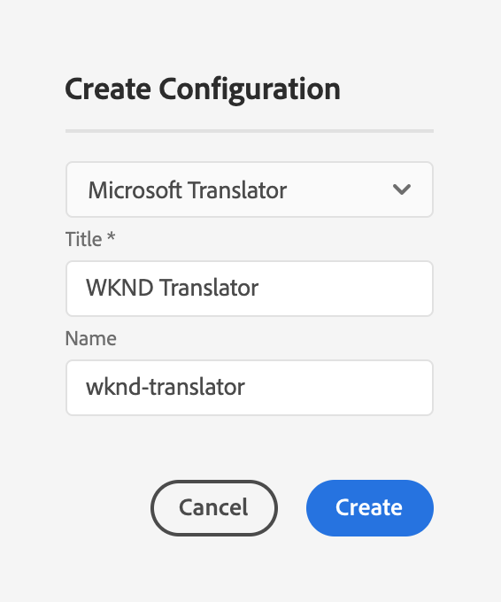
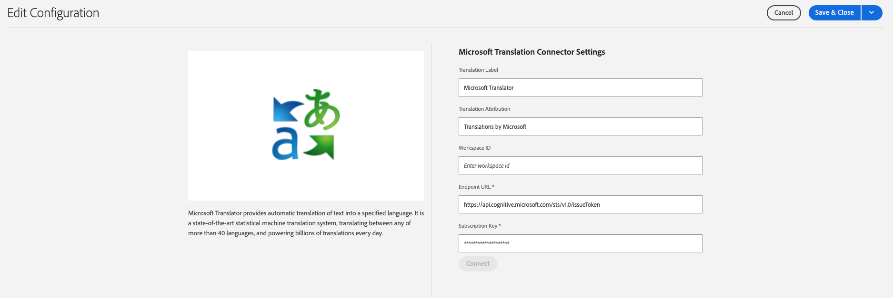

# Microsoft Translator에 연결 {#connecting-to-microsoft-translator}

AEM은 페이지 콘텐츠 또는 에셋을 번역할 수 있도록 [Microsoft Translator](https://www.microsoft.com/en-us/translator/business/)에 내장된 커넥터를 제공합니다. Microsoft에서 Microsoft Translator 사용 라이선스를 받은 후 이 페이지의 지침에 따라 커넥터를 구성하십시오.

| 속성 | 설명 |
|---|---|
| 번역 레이블 | 번역 서비스의 표시 이름 |
| 번역 속성 | (선택 사항) 사용자 생성 콘텐츠의 경우, 번역된 텍스트 옆에 표시되는 속성(예: `Translations by Microsoft`) |
| 작업 영역 ID | (옵션) 사용할 맞춤화된 Microsoft Translator 엔진의 ID |
| 구독 키 | Microsoft Translator에 대한 Microsoft 구독 키 |

다음 절차를 통해 Microsoft Translator 구성이 생성됩니다.

1. [탐색 패널에서 &#x200B;](/help/sites-authoring/basic-handling.md#first-steps)을(를) 클릭합니다. **도구** > **클라우드 서비스** > **번역 클라우드 서비스**.
1. 구성을 만들고자 하는 위치로 이동합니다. 일반적으로 이는 사이트 루트에 있거나 전역 기본 구성일 수 있습니다.
1. **만들기** 단추를 클릭합니다.
1. 구성을 정의합니다.
   1. 드롭다운 목록에서 **Microsoft Translator**&#x200B;를 선택합니다.
   1. 구성의 제목을 입력합니다. 제목을 통해 클라우드 서비스 콘솔 및 페이지 속성 드롭다운 목록에서 구성을 식별합니다.
   1. 필요한 경우 구성을 저장하는 저장소 노드에 사용할 이름을 입력합니다.

   

1. **만들기**&#x200B;를 클릭합니다.
1. **구성 편집** 창에서 이전 테이블에서 설명된 번역 서비스에 대한 값을 입력합니다.

   

1. 연결을 확인하려면 **연결**&#x200B;을 클릭하세요.
1. **저장 및 닫기**&#x200B;를 클릭합니다.

## Translator 서비스 구성 게시 {#publishing-the-translator-service-configurations}

마지막 단계로 [트리 게시](/help/sites-authoring/publishing-pages.md#publishing-and-unpublishing-a-tree) 작업을 사용하여 게시된 번역된 콘텐츠를 지원하도록 Microsoft Translator 구성을 게시하십시오.

## Microsoft Translator API 필드 매핑 {#microsoft-translator-api-field-mapping}

Microsoft Translator API v3가 `https://api.cognitive.microsofttranslator.com/translate?api-version=3.0`에서 번역 요청을 수락합니다. 대상 언어를 포함한 필수 매개 변수에 대해서는 [Microsoft 번역 API 참조](https://learn.microsoft.com/en-us/azure/ai-services/translator/text-translation/reference/v3/translate)를 참조하십시오.

다음 표는 AEM 구성 필드와 Microsoft API를 연결합니다.

| AEM 필드 | AEM의 목적 | Microsoft API 관계 |
|---|---|---|
| 작업 영역 ID | 사용할 맞춤화된 Microsoft Translator 엔진을 식별합니다. | 사용자 지정 번역 시스템은 `category` 요청 매개 변수를 통해 선택됩니다. Microsoft의 API에는 작업 영역 ID만 있는 것이 아니라 사용자 지정 Translator 범주 ID가 필요합니다. 커넥터 및 사용자 지정 모델 구성에 필요한 값을 확인합니다. |
| 번역 레이블 | 번역 서비스의 표시 이름을 제공합니다. | 해당 번역 요청 매개 변수가 없습니다. |
| 번역 속성 | 번역된 사용자 생성 콘텐츠 옆에 선택적 속성을 정의합니다. | 해당 번역 요청 매개 변수가 없습니다. |
| 구독 키 | Microsoft Translator 구독에 대한 액세스 권한을 인증합니다. | 액세스 토큰을 요청할 때 `Ocp-Apim-Subscription-Key` 헤더에서 전송됩니다. 그러면 토큰이 번역 요청을 위해 `Authorization: Bearer <access-token>` 헤더로 전송됩니다. |

글로벌 Microsoft Translator 리소스의 경우 토큰 끝점은 `https://api.cognitive.microsoft.com/sts/v1.0/issueToken`입니다. 지역 및 다중 서비스 리소스는 지역별 토큰 엔드포인트를 사용합니다. 리소스 유형에 대한 끝점 및 헤더 요구 사항에 대해서는 [Microsoft Translator 인증](https://learn.microsoft.com/en-us/azure/ai-services/translator/text-translation/reference/authentication)을 참조하십시오.
