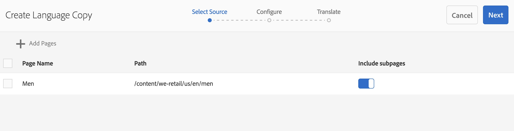
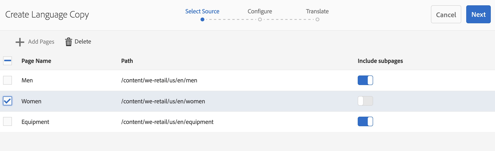

# 언어 복사 마법사{#language-copy-wizard}

언어 복사 마법사는 다국어 콘텐츠 구조 생성 및 측정을 위한 안내형 경험입니다. 이제 언어 사본을 만드는 것이 훨씬 간단하고 빠릅니다.

>[!NOTE]
>
>사이트의 언어 사본을 만들려면 사용자는 프로젝트-관리자 그룹의 멤버여야 합니다.

이 마법사에 액세스하려면:

1. Sites에서 페이지를 선택하고 생성을 누릅니다.

   

1. 언어 사본 을 선택하면 마법사가 열립니다.

   

1. 마법사의 **Source 선택** 단계를 통해 페이지를 추가/제거할 수 있습니다. 하위 페이지를 포함하거나 제외할 수 있는 옵션도 있습니다.

   

1. **다음** 단추를 클릭하면 마법사의 **구성** 단계로 이동합니다. 여기에서 언어를 추가/제거하고 번역 방법을 선택할 수 있습니다.

   

   >[!NOTE]
   >
   >기본적으로 번역 설정은 하나만 표시됩니다. 다른 설정을 선택하려면 먼저 클라우드 구성을 구성해야 합니다. [번역 통합 프레임워크 구성](/help/sites-administering/tc-tic.md)을 참조하십시오.

1. **다음** 단추를 클릭하면 마법사의 **번역** 단계로 이동합니다. 여기서 구조만 만들거나, 번역 프로젝트를 만들거나, 기존 번역 프로젝트에 추가할 수 있습니다.

   >[!NOTE]
   >
   >이전 단계에서 여러 언어를 선택한 경우 여러 작업 프로젝트가 생성됩니다.

   

1. **만들기** 버튼을 클릭하면 마법사가 종료됩니다.

   
