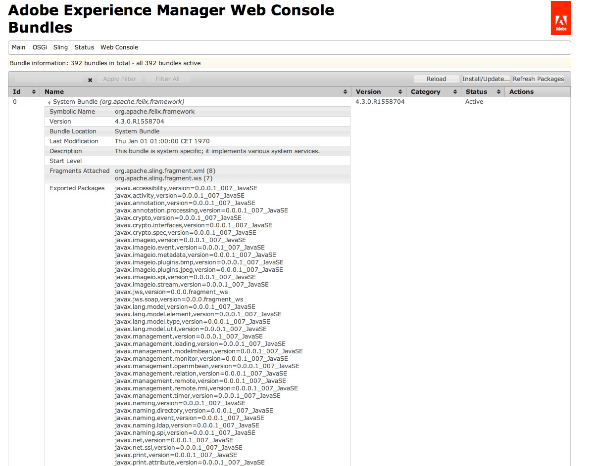

# Adobe Experience Manager 문제 해결 {#troubleshooting-aem}

다음 섹션에서는 AEM(Adobe Experience Manager)를 사용할 때 발생할 수 있는 몇 가지 문제와 그 해결 방법에 대한 제안을 다룹니다.

>[!NOTE]
>
>AEM에서 작성 문제를 해결하는 경우 [작성자 문제 해결](/help/sites-authoring/troubleshooting.md)을 참조하십시오.

>[!NOTE]
>
>문제가 발생하면 인스턴스(릴리스 및 서비스 팩)에 대한 [알려진 문제](/help/release-notes/release-notes.md) 목록을 확인하는 것도 좋습니다.

## 관리자를 위한 문제 해결 시나리오 {#troubleshooting-scenarios-for-administrators}

다음 표는 관리자가 해결할 수 있는 문제에 대한 개요를 제공합니다.

<table>
 <tbody>
  <tr>
   <td><strong>역할</strong></td>
   <td><strong>문제 </strong></td>
  </tr>
  <tr>
   <td>시스템 관리자</td>
   <td>
Quickstart jar를 두 번 클릭해도 아무런 효과가 없거나 다른 프로그램(예: archive manager)으로 jar 파일을 엽니다.
 </td>
  </tr>
  <tr>
   <td>
시스템 관리자
 </td>
   <td>
CRX에서 실행되는 응용 프로그램에서 메모리 부족 오류가 발생합니다.
 </td>
  </tr>
  <tr>
   <td>
시스템 관리자
 </td>
   <td>
AEM CM 빠른 시작을 두 번 클릭한 후 AEM 시작 화면이 브라우저에 표시되지 않습니다
 </td>
  </tr>
  <tr>
   <td>
시스템 관리자
 
관리 사용자
 </td>
   <td>
스레드 덤프 만들기
 </td>
  </tr>
  <tr>
   <td>
시스템 관리자
 
관리 사용자
 </td>
   <td>
닫히지 않은 JCR 세션 확인
 </td>
  </tr>
 </tbody>
</table>

## 설치 문제 {#installation-issues}

다음 문제 해결 시나리오에 대한 자세한 내용은 [일반적인 설치 문제](/help/sites-deploying/troubleshooting.md#common-installation-issues)를 참조하십시오.

* Quickstart jar를 두 번 클릭해도 효과가 없거나 JAR 파일이 다른 프로그램(예: 아카이브 관리자)과 함께 표시됩니다.
* CRX에서 실행되는 응용 프로그램에서 메모리 부족 오류가 발생합니다.
* AEM 빠른 시작을 두 번 클릭한 후 AEM 시작 화면이 브라우저에 표시되지 않습니다.

## 분석 문제 해결 방법 {#methods-for-troubleshooting-analysis}

### 스레드 덤프 만들기 {#making-a-thread-dump}

스레드 덤프는 현재 활성 상태인 모든 Java™ 스레드 목록입니다. AEM이 제대로 응답하지 않으면 스레드 덤프를 통해 교착 상태나 기타 문제를 식별하는 데 도움이 될 수 있습니다.

### Sling 스레드 덤퍼 사용 {#using-sling-thread-dumper}

1. **AEM 웹 콘솔**&#x200B;을 엽니다(예: `https://localhost:4502/system/console/`).
1. **Threads**&#x200B;아래&#x200B;**상태** 탭을 선택합니다.

### jstack(명령줄) 사용 {#using-jstack-command-line}

1. AEM Java™ 인스턴스의 PID(프로세스 ID)를 찾습니다.

   예를 들어 `ps -ef` 또는 `jps`을(를) 사용할 수 있습니다.

1. 실행:

   `jstack <pid>`

1. 스레드 덤프를 표시합니다.

>[!NOTE]
>
>`>>` 출력 리디렉션을 사용하여 스레드 덤프를 로그 파일에 추가할 수 있습니다.
>
>`jstack <pid> >> /path/to/logfile.log`

자세한 내용은 [JVM에서 스레드 덤프를 가져오는 방법](https://experienceleague.adobe.com/docs/experience-cloud-kcs/kbarticles/KA-17452.html?lang=ko) 설명서를 참조하십시오

### 닫히지 않은 JCR 세션 확인 {#checking-for-unclosed-jcr-sessions}

AEM WCM에 대한 기능이 개발되면 JCR 세션을 열 수 있습니다(데이터베이스 연결을 여는 것과 비슷함). 열려 있는 세션이 닫히지 않으면 시스템에 다음과 같은 증상이 나타날 수 있습니다.

* 시스템이 느려집니다.
* CacheManager: resizeAll 항목이 로그 파일에 있습니다. 이 값은 다음 숫자입니다(크기=&lt;x>) shows the number of caches, each session opens several caches.).
* 때때로 시스템에서 메모리가 부족합니다(심각도에 따라 몇 시간, 며칠 또는 몇 주 후).

닫히지 않은 세션 분석을 시작하려면 기술 자료 문서 [닫히지 않은 리소스 확인자](https://experienceleague.adobe.com/ko/docs/experience-cloud-kcs/kbarticles/ka-23761)를 참조하세요.

### Adobe Experience Manager 웹 콘솔 사용 {#using-the-adobe-experience-manager-web-console}

또한 OSGi 번들의 상태를 통해 가능한 문제를 조기에 파악할 수 있습니다.

1. **AEM 웹 콘솔**&#x200B;을 엽니다(예: `https://localhost:4502/system/console/`).
1. **OSGI** 탭에서 **번들**&#x200B;을(를) 선택합니다.
1. 확인:

   * 번들의 상태. 비활성 또는 미충족 상태인 경우 번들을 중지했다가 다시 시작하십시오. 문제가 지속되면 다른 방법을 사용하여 자세히 알아보십시오.
   * 누락된 종속성이 있는 번들이 있는지 여부. 이러한 세부 사항은 링크인 개별 번들 이름을 클릭하여 볼 수 있습니다(다음 예에는 문제가 없음).

