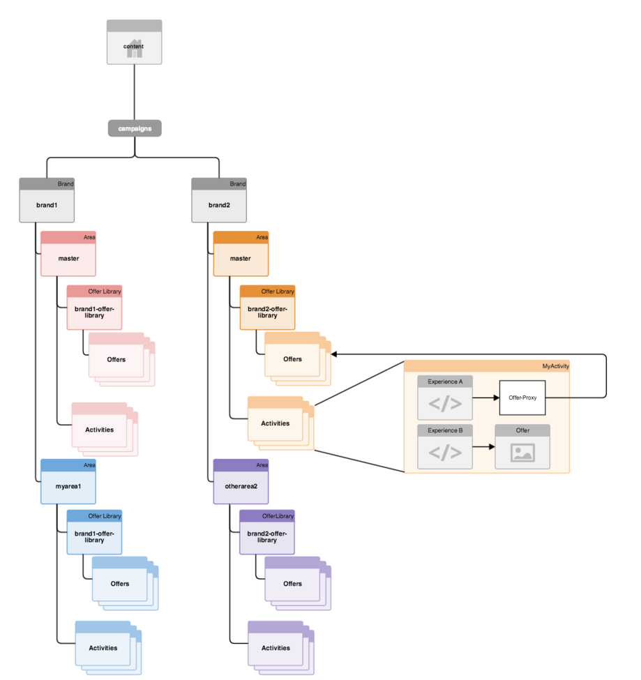

# 타겟팅된 콘텐츠에 대한 다중 사이트 관리 구성 방식{#how-multisite-management-for-targeted-content-is-structured}

다음 다이어그램은 타겟팅된 콘텐츠에 대한 다중 사이트 지원이 구조화되는 방식을 보여 줍니다.

영역은 **/content/campaigns/&lt;brand>** 아래에 표시되며 기본적으로 각 브랜드에는 자동으로 생성되는 마스터 영역이 있습니다. 각 영역에는 영역만의 활동, 경험 및 오퍼 세트가 있습니다.

타겟팅된 콘텐츠를 조회하기 위해 페이지 또는 사이트를 영역에 매핑할 수 있습니다. 구성된 영역이 없으면 AEM은 이 특정 브랜드의 마스터 영역으로 돌아갑니다.

다음 다이어그램은 site1, site2 및 site3이라는 세 개의 사이트에 대해 논리가 작동하는 방식에 대한 예입니다.

* site1은 영역 매핑을 기반으로 myarea1에서 brand1을 찾고 otherarea2에서 brand2를 찾습니다.
* site2는 brand1에 대한 영역 매핑만 정의되므로 brand1에 대한 myarea1과 brand2에 대한 마스터 영역을 조회합니다.
* 이 사이트에 대해 다른 영역 매핑이 전혀 정의되어 있지 않으므로 site3은 brand1 및 brand2에 대한 마스터 영역을 조회합니다.
