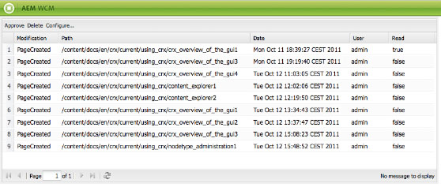
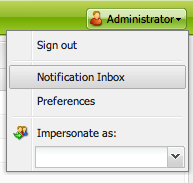
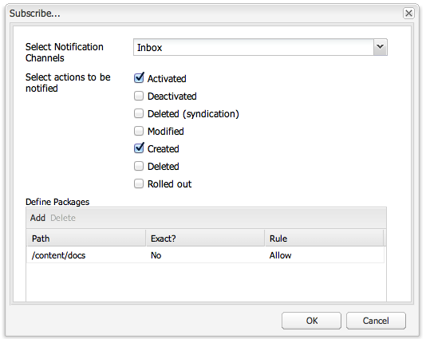
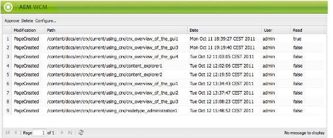

# 받은 편지함{#your-inbox}

AEM의 다양한 영역에서 작업 항목에 대한 알림 또는 페이지 콘텐츠에서 수행해야 하는 작업을 나타내는 작업과 같은 알림을 받을 수 있습니다.

이러한 알림은 알림 유형으로 구분된 두 개의 받은 편지함으로 수신됩니다.

* 가입 결과로 받은 알림을 볼 수 있는 받은 편지함은 다음 섹션에 설명되어 있습니다.
* 워크플로 항목에 대한 특수 받은 편지함은 [워크플로에 참여](/help/sites-classic-ui-authoring/classic-workflows-participating.md) 문서에 설명되어 있습니다.

## 알림 보기 {#viewing-your-notifications}

알림을 보려면:

1. 알림 받은 편지함을 엽니다. **웹 사이트** 콘솔에서 오른쪽 상단의 사용자 단추를 클릭하고 **알림 받은 편지함**&#x200B;을 선택합니다.

   

   >[!NOTE]
   >
   >브라우저에서 직접 콘솔에 액세스할 수도 있습니다. 예를 들면 다음과 같습니다.
   >
   >
   >` https://<host>:<port>/libs/wcm/core/content/inbox.html`

1. 알림이 나열됩니다. 필요에 따라 작업을 수행할 수 있습니다.

   * [알림 구독 중](#subscribing-to-notifications)
   * [알림 처리](#processing-your-notifications)

   

## 알림 구독 중 {#subscribing-to-notifications}

알림을 구독하려면 다음 작업을 수행하십시오.

1. 알림 받은 편지함을 엽니다. **웹 사이트** 콘솔에서 오른쪽 상단의 사용자 단추를 클릭하고 **알림 받은 편지함**&#x200B;을 선택합니다.

   

   >[!NOTE]
   >
   >브라우저에서 직접 콘솔에 액세스할 수도 있습니다. 예를 들면 다음과 같습니다.
   >
   >
   >`https://<host>:<port>/libs/wcm/core/content/inbox.html`

1. 왼쪽 상단 모서리에서 **구성...**&#x200B;을 클릭하여 구성 대화 상자를 엽니다.

   

1. 알림 채널 선택:

   * **받은 편지함**: 알림이 AEM 받은 편지함에 표시됩니다.
   * **전자 메일**: 알림이 사용자 프로필에 정의된 전자 메일 주소로 전자 메일로 전송됩니다.

   >[!NOTE]
   >
   >전자 메일로 알림을 받으려면 몇 가지 설정을 구성해야 합니다. 이메일 템플릿을 사용자 정의하거나 새 언어에 대한 이메일 템플릿을 추가할 수도 있습니다. AEM에서 전자 메일 알림을 구성하려면 [전자 메일 알림 구성](/help/sites-administering/notification.md#configuringemailnotification)을 참조하십시오.

1. 알림을 받을 페이지 작업 선택:

   * 활성화됨: 페이지가 활성화되면 표시됩니다.
   * 비활성화됨: 페이지가 비활성화되었을 때.
   * 삭제됨(신디케이션): 페이지가 삭제-복제되었을 때, 즉 페이지에서 수행된 삭제 작업이 복제되었을 때.
     페이지를 삭제하거나 이동하면 삭제 작업이 자동으로 복제됩니다. 삭제 작업이 수행된 소스 인스턴스와 복제 에이전트가 정의한 대상 인스턴스에서 페이지가 삭제됩니다.

   * 수정됨: 페이지가 수정된 경우.
   * 생성됨: 페이지를 생성할 때.
   * 삭제됨: 페이지 삭제 작업을 통해 페이지가 삭제된 경우.
   * 롤아웃: 페이지가 롤아웃된 때입니다.

1. 알림을 받을 페이지의 경로를 정의합니다.

   * 테이블에 새 행을 추가하려면 **추가**&#x200B;를 클릭하십시오.
   * **경로** 테이블 셀을 클릭하고 `/content/docs`과(와) 같은 경로를 입력합니다.

   * 하위 트리에 속하는 모든 페이지에 대한 알림을 받으려면 **정확한?**&#x200B;을(를) 설정하십시오. **아니요**(으)로
     경로에 정의된 페이지에서 작업에 대한 알림만 받으려면 **정확한?**&#x200B;을(를) 설정하십시오. 을(를) **예**(으)로 바꿉니다.

   * 규칙을 허용하려면 **규칙**&#x200B;을(를) **허용**(으)로 설정하십시오. **Deny**(으)로 설정하면 규칙이 거부되지만 제거할 수 없으며 나중에 허용할 수 있습니다.

   정의를 제거하려면 표 셀을 클릭하여 행을 선택하고 **삭제**&#x200B;를 클릭합니다.

1. 구성을 저장하려면 **확인**&#x200B;을 클릭하세요.

## 알림 처리 {#processing-your-notifications}

AEM 받은 편지함에서 알림을 받도록 선택한 경우 받은 편지함이 알림으로 가득 채워집니다. [알림을 확인](#viewing-your-notifications)한 다음 필요한 알림을 선택하여 다음 작업을 수행할 수 있습니다.

* **승인**&#x200B;을 클릭하여 수락하십시오. **읽기** 열의 값이 **true**(으)로 설정되어 있습니다.

* **삭제**&#x200B;를 클릭하여 제거하십시오.

