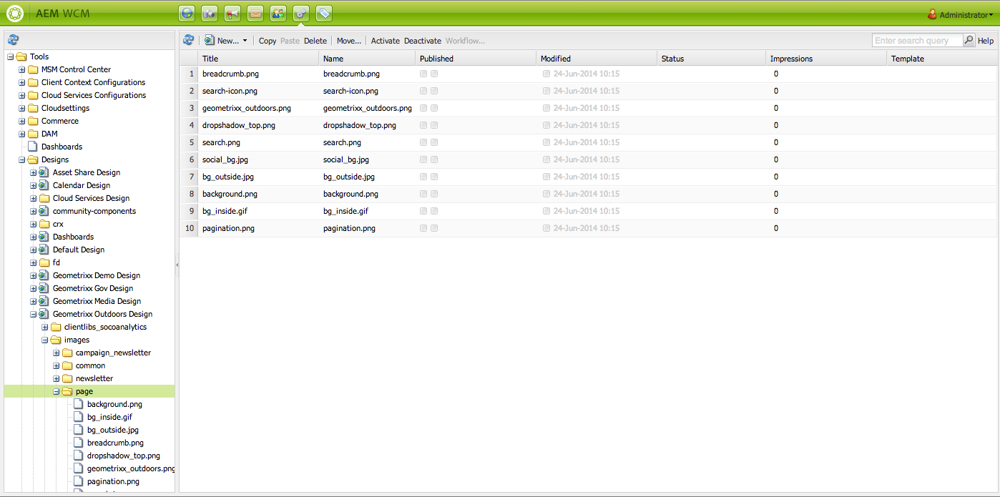

# 디자인 및 Designer{#designs-and-the-designer}

>[!CAUTION]
>
>이 문서에서는 클래식 UI를 기반으로 웹 사이트를 만드는 방법을 설명합니다. Adobe에서는 문서 [AEM Sites 개발 시작하기](/help/sites-developing/getting-started.md)에 자세히 설명된 대로 웹 사이트에 최신 AEM 기술을 사용하는 것이 좋습니다.

Designer은 AEM에서 [클래식 UI](/help/release-notes/touch-ui-features-status.md)를 사용하여 웹 사이트의 디자인을 만드는 데 사용됩니다.

>[!NOTE]
>
>웹 액세스 가능성에 대한 자세한 내용은 [AEM 및 웹 액세스 가능성 지침](/help/managing/web-accessibility.md)을 참조하세요.

## Designer 사용 {#using-the-designer}

디자인은 **도구** 탭의 **디자인** 섹션에서 정의할 수 있습니다.



여기에서 디자인을 저장하는 데 필요한 구조를 만든 다음, 계단식 스타일 시트 및 필요한 이미지를 업로드할 수 있습니다.

디자인은 `/apps/<your-project>`에 저장됩니다. `jcr:content` 노드의 `cq:designPath` 속성을 사용하여 웹 사이트에 사용할 디자인의 경로를 지정합니다.


>[!NOTE]
>
>디자인 모드의 페이지에서 수행된 모든 변경 사항은 사이트의 디자인 노드 아래에 유지되며, 동일한 디자인을 가지는 모든 페이지에 자동으로 적용됩니다.

## 필요 사항 {#what-you-will-need}

디자인을 실현하려면 다음이 필요합니다.

**CSS** - CSS 스타일시트는 페이지의 특정 영역의 형식을 정의합니다.
**이미지** - 배경, 단추 등의 기능에 사용하는 모든 이미지.

### 웹 사이트 디자인 시 고려 사항 {#considerations-when-designing-your-website}

웹 사이트를 개발할 때는 다음 코드 조각에 설명된 대로 현재 디자인을 기반으로 리소스를 참조할 수 있도록 `/apps/<your-project>` 아래에 이미지와 CSS 파일을 저장하는 것이 좋습니다.

```xml
<%= currentDesign.getPath() + "/static/img/icon.gif %>
```

앞의 예제에서는 다음과 같은 몇 가지 이점을 제공합니다.

* 구성 요소는 다른 디자인 경로를 사용하여 각 사이트에 따라 다른 모양/느낌을 가질 수 있습니다.
* `design/v1`에서 `design/v2.` 사이의 사이트 루트에 있는 다른 노드에 대한 디자인 경로를 지정하여 웹 사이트를 다시 디자인할 수 있습니다.

* `/etc/designs` 및 `/content`은(는) 외부 사용자가 `/apps` 트리 아래에 있는 내용에 대해 궁금해하는 것을 보호하는 것으로 브라우저에 표시되는 유일한 외부 URL입니다. 위의 URL 이점은 자산 노출을 몇 개의 개별 위치로 제한하므로 시스템 관리자가 보안을 더 잘 설정하는 데도 도움이 됩니다.
