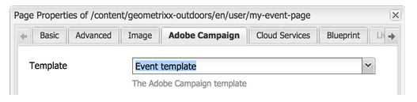
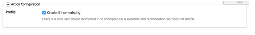
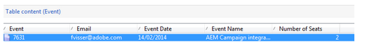

# 사용자 지정 양식 매핑 만들기{#creating-custom-form-mappings}

Adobe Campaign에서 사용자 지정 테이블을 만들 때 해당 사용자 지정 테이블에 매핑되는 양식을 AEM에서 빌드할 수 있습니다.

이 문서에서는 사용자 정의 양식 매핑을 만드는 방법을 설명합니다. 이 문서의 단계를 완료하면 다가오는 이벤트에 등록할 수 있는 이벤트 페이지를 사용자에게 제공합니다. 그런 다음 Adobe Campaign을 통해 이러한 사용자를 후속 조치합니다.

## 사전 요구 사항 {#prerequisites}

다음을 설치해야 합니다.

* Adobe Experience Manager
* Adobe Campaign Classic

자세한 내용은 [AEM과 Adobe Campaign Classic 통합](/help/sites-administering/campaignonpremise.md)을 참조하십시오.

## 사용자 지정 양식 매핑 만들기 {#creating-custom-form-mappings-2}

사용자 정의 양식 매핑을 생성하려면 다음 섹션에 자세히 설명되어 있는 이러한 높은 수준의 단계를 수행해야 합니다.

1. 사용자 지정 테이블을 만듭니다.
1. **seed** 테이블을 확장합니다.
1. 사용자 지정 매핑을 만듭니다.
1. 사용자 지정 매핑을 기반으로 게재를 만듭니다.
1. 생성된 게재를 사용할 AEM에서 양식을 작성합니다.
1. 테스트할 양식을 제출합니다.

### Adobe Campaign에서 사용자 지정 테이블 만들기 {#creating-the-custom-table-in-adobe-campaign}

Adobe Campaign에서 사용자 지정 테이블을 만들어 시작합니다. 이 예제에서는 다음 정의를 사용하여 이벤트 테이블을 만듭니다.

```xml
<element autopk="true" label="Event" labelSingular="Event" name="event">
 <attribute label="Event Date" name="eventdate" type="date"/>
 <attribute label="Event Name" name="eventname" type="string"/>
 <attribute label="Email" name="email" type="string"/>
 <attribute label="Number of Seats" name="seats" type="long"/>
</element>
```

이벤트 테이블을 만든 후 **데이터베이스 구조 업데이트 마법사**&#x200B;를 실행하여 테이블을 만듭니다.

### 시드 테이블 확장 {#extending-the-seed-table}

Adobe Campaign에서 **추가**&#x200B;를 선택하여 **시드 주소(nms)** 테이블의 확장을 만듭니다.


이제 **event** 테이블의 필드를 사용하여 **seed** 테이블을 확장합니다.

```xml
<element label="Event" name="custom_cus_event">
 <attribute name="eventname" template="cus:event:event/@eventname"/>
 <attribute name="eventdate" template="cus:event:event/@eventdate"/>
 <attribute name="email" template="cus:event:event/@email"/>
 <attribute name="seats" template="cus:event:event/@seats"/>
 </element>
```

그런 다음 **데이터베이스 업데이트 마법사**&#x200B;를 실행하여 변경 내용을 적용합니다.

### 사용자 지정 대상 매핑 만들기 {#creating-custom-target-mapping}

**관리/캠페인 관리** t에서 **대상 매핑**(으)로 이동하여 새 T **대상 매핑을 추가하십시오.**

>[!NOTE]
>
>**내부 이름**&#x200B;에 의미 있는 이름을 사용해야 합니다.


### 사용자 지정 게재 템플릿 만들기 {#creating-a-custom-delivery-template}

이 단계에서는 만들어진 **대상 매핑**&#x200B;을 사용하는 게재 템플릿을 추가합니다.

**리소스/템플릿**&#x200B;에서 게재 템플릿으로 이동하여 기존 AEM 게재를 복제합니다. **받는 사람**&#x200B;을(를) 클릭하면 이벤트 만들기 **대상 매핑**&#x200B;을(를) 선택하십시오.


### AEM에서 양식 작성 {#building-the-form-in-aem}

AEM에서 **페이지 속성**&#x200B;에 Cloud Service을 구성했는지 확인하십시오.

그런 다음 **Adobe Campaign** 탭에서 [사용자 지정 게재 템플릿 만들기](#creating-a-custom-delivery-template)에서 만든 게재를 선택합니다.



필드를 구성할 때는 양식 필드에 고유한 요소 이름을 지정해야 합니다.

필드가 구성된 후 매핑을 수동으로 변경해야 합니다.

CRXDE-lite에서 (페이지의) **jcr:content** 노드로 이동하여 **acMapping** 값을 **Target 매핑**&#x200B;의 내부 이름으로 변경합니다.


양식 구성에서 존재하지 않는 경우 작성하려면 확인란을 선택해야 합니다



### 양식 제출 {#submitting-the-form}

이제 양식을 제출하고 Adobe Campaign 측에서 값이 저장되었는지 여부를 확인할 수 있습니다.



## 문제 해결 {#troubleshooting}

**&quot;@eventdate&#39; 요소의 값 &#39;02/02/2015&#39; 형식이 잘못되었습니다(&#39;Event([adb:event])&#39; 형식의 문서)&quot;**

양식을 제출할 때 이 오류는 AEM의 **error.log**&#x200B;에 기록됩니다.

날짜 필드의 형식이 잘못되었기 때문입니다. 해결 방법은 값으로 **yyyy-mm-dd**&#x200B;을(를) 제공하는 것입니다.
